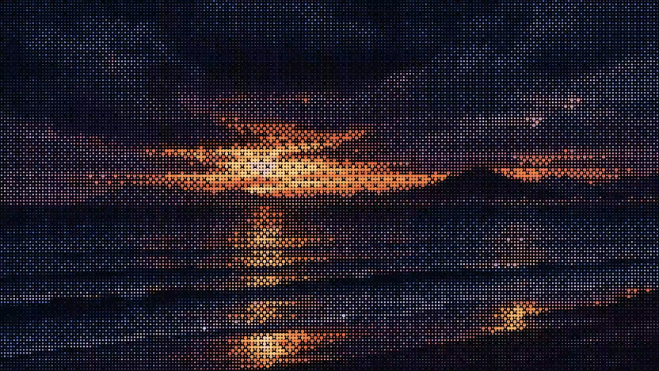

# 实景ASCII风景动画 · ASCII Scene Animation

GitHub：[logic0512/ascii-scene-animation](https://github.com/logic0512/ascii-scene-animation)

根据地点或上传图片制作**真正由字符网格和有限颜色逐帧驱动的ASCII风景演示动画**。先确认主题、地标与空间，再设计好看的取景和光影，将ascii.rest的绘制方法迁移到真实中国题材。

成果以实际字符播放器为准。内部PNG仅用于构图、色光和采样，不是ASCII成果，也不作为封面或下载效果承诺。

## 查看真实效果

内置动画可通过本地HTTP服务在浏览器直接播放，不需要图像模型、API密钥或Node。ASCII字符渲染在本机免费、离线执行。

例如在仓库目录执行 `python3 -m http.server 8080`，浏览 [http://localhost:8080/examples/](http://localhost:8080/examples/)。入口为 [examples/index.html](examples/index.html)；直接双击HTML可能无法加载模块或资料。

15个中国相关主题的来源、艺术方向与逐例状态见 [案例清单](examples/manifest.json)和[案例依据](references/china-cases.md)。规格为208×117字符、目标调度15fps、最多64色，通过上游 `mount` 绘制；实际帧率取决于运行环境。15例实际字符画面已逐个查看，并在Chrome检查到时间推进与画面变化，记录见 [动画核验](references/visual-review.md)。

缩略图、主预览和导出来自同一字符渲染。画廊请求录制约5秒同Canvas动画，浏览器选择支持的WebM或MP4格式，不提供内部PNG导出。三亚样例的WebM已实际导出并播放检查：4.88秒、62帧、2880×1620；其余14例视频导出与MP4兼容性未逐一验证。

下方动图由这段实际视频缩小、降至10fps制作，没有用内部PNG合成；完整效果以实时播放器及[原始视频](examples/sanya-sunset/demo.webm)为准。不承诺无缝循环。



## 安装与使用

将完整文件夹复制到你的 Skill 目录，命名为 `ascii-scene-animation`。Codex 常用位置为 `~/.codex/skills/ascii-scene-animation`；其他支持 `SKILL.md` 的代理使用各自安装位置。保留相对目录，更新已有安装时保留自己的修改。

```text
使用 $ascii-scene-animation，做大梅沙的ASCII海岸演示动画，要看到海和羽翼人物雕塑。
先核实七座雕塑与海岸空间，再规划取景和蓝调光影；最后实际播放字符动画检查，不拿内部PNG当成品。
```

```text
使用 $ascii-scene-animation，基于我上传的图片做彩色ASCII动画。
保留建筑、人物数量、岸线和构图，用稳定字符轮廓表现主体，只在适合的环境区域加入动态。
```

```text
使用 $ascii-scene-animation，制作武汉黄鹤楼暮色ASCII动画。
核实主楼与江桥关系，设计屋檐暖光和远城层次；预览和视频都使用同一字符播放器。
```

找图用于实景求证，地点创作可重新构图、美化和设计昼夜，记录艺术化改变。上传图默认忠实保留结构。地标形制、雕塑群总量、物种与合理空间仍以实景为准，不能让中国园林带入日式五重塔。敦煌月牙泉可以创作星夜；地月题材注明来自中国探月工程影像，非中国境内风景。

## 方法与运行要求

本项目借鉴 [ascii.rest](https://ascii.rest/)及 [bas3line/ascii](https://github.com/bas3line/ascii) 的15组方法，包括山体分面、极光帘幕、水下透射光、沙坡星尘、球面硬光、园林暮色、灯光纵深、水岸灯链、分层雾、夜海碎波、落日反射、体积云雨、建筑晨光、湿街光晕和暮岸暖光。方法用于组织内容与表现，不是直接换地名的模板或单一调色板。本项目为独立封装，非官方Skill。

观看内置案例只需本地HTTP服务和浏览器。制作新地点时，需要代理核实主题、设计并实现字符场景；若要生成新的内部构图素材，才需要图像生成/编辑模型。ASCII采样、字符渲染与环境运动在本机执行，无模型调用费用，不需要在线图像服务。模型不能保证建筑几何和数量，字符化后还可能丢失细节，因此必须检查真正的字符结果。本包不包含图像模型、API密钥或付费额度。

浏览器承担画廊播放和视频录制。以下Node 23.6+脚本只用于开发/检查，不是内置案例播放依赖：

```sh
node scripts/scene.mjs check-library
node scripts/scene.mjs reference night-coast /path/to/empty-directory
node scripts/scene.mjs verify-brief /path/to/brief.json
node scripts/self-check.mjs
node scripts/gallery-self-check.mjs
```

`reference`展示原作供研究，不生成指定地点。自动检查能验证指纹、记录或代码契约，不能证明地标准确、美观、运动自然或导出正确。[核验说明](references/visual-review.md)区分内部素材检查、实际字符播放检查和视频验证。

## 文档与来源

- [Skill入口](SKILL.md)与[制作方法](references/method.md)。
- [15组技法](references/scenes.md)与[中国案例依据](references/china-cases.md)。
- [来源与版本](references/provenance.md)、[许可](LICENSE)、[第三方说明](THIRD_PARTY_NOTICES.md)。

本项目自己编写的代码和文档按MIT许可提供；上游保留 [bas3line的MIT许可](assets/ascii/LICENSE)，19个原文件指纹见 [upstream.json](references/upstream.json)。展示注明程序生成的ASCII艺术、非实拍，内部AI素材另标AI生成。第三方求证照片只链接来源，不随仓库分发；项目MIT许可不授予这些照片的使用权，不虚构原作者或摄影作者的授权。
